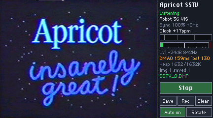
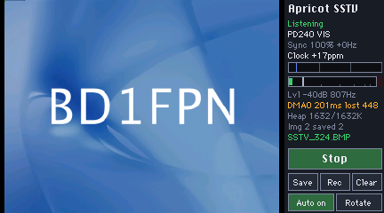

# Apricot SSTV

A slow-scan television (SSTV) receiver for the **iPod nano 7th generation**.
Feed radio audio into the headset microphone input, and Apricot SSTV decodes
the pictures live on the iPod's screen and saves them as BMP files.

It runs as a [NanoApps](https://github.com/nfzerox/NanoApps) app on RetailOS 1.1.2. It decodes
14 modes, detects the mode from the VIS header, can lock on without a VIS,
corrects the sender's clock error so pictures come out straight, and carries
a picture through fades and capture gaps.

| Robot 36 | PD240 |
|---|---|
|  |  |

## Features

- **14 modes:** Robot 36/72, Martin M1/M2, Scottie S1/S2/DX, and every PD
  mode from PD50 to PD290, including PD120 (the ISS's usual mode).
- **Automatic start:** reads the VIS header and its tuning offset (±150 Hz),
  or locks onto any supported mode's sync pulses when the VIS was missed.
- **Slant correction:** fits the line period to the received syncs, reports
  the sender's clock error in ppm, and straightens lines already drawn. The
  measured error carries over to the next picture.
- **Fade and gap recovery:** a picture interrupted by a fade or a capture gap
  continues on the same line grid when the signal returns (within 2 minutes),
  instead of starting again at the top.
- **Gapless capture:** reads the capture DMA's live write position, so audio
  isn't lost to the UI's frame timing.
- **Live display:** the picture builds line by line in a 320×240 area beside
  a status strip with a tuning bar and a dBFS level meter.
- **Saving:** finished pictures save automatically as BMP; SAVE saves on
  demand, and REC records 12 s of raw input as a WAV for analysis.
- **Small and self-contained:** no libm, no LVGL, about 465 KB of app memory
  plus a 540 KB block borrowed from the system while listening.

## Supported modes

| Mode | VIS | Picture | Length | Colour |
|---|---|---|---|---|
| Robot 36 | 8 | 320×240 | 36 s | YUV, alternating chroma |
| Robot 72 | 12 | 320×240 | 72 s | YUV |
| Martin M1 / M2 | 44 / 40 | 320×256 | 114 / 58 s | GBR |
| Scottie S1 / S2 | 60 / 56 | 320×256 | 110 / 71 s | GBR |
| Scottie DX | 76 | 320×256 | 269 s | GBR |
| PD50 / PD90 | 93 / 99 | 320×256 | 50 / 90 s | YUV, 2 rows per sync |
| PD120 | 95 | 640×496 → 320×248 | 126 s | YUV, 2 rows per sync |
| PD160 | 98 | 512×400 → 256×200 | 161 s | YUV, 2 rows per sync |
| PD180 / PD240 | 96 / 97 | 640×496 → 320×248 | 187 / 248 s | YUV, 2 rows per sync |
| PD290 | 94 | 800×616 → 400×308 | 289 s | YUV, 2 rows per sync |

Modes wider than 400 pixels are decoded at half size: each pixel is sampled
over twice the width, and each sync's two rows are averaged. That's still
more detail than the screen shows, and it keeps memory use fixed. Saved BMPs
are the decoded size. A VIS code for an unsupported mode shows `Skip <mode>`.

## Requirements

- An iPod nano 7th generation on RetailOS 1.1.2.
- **[NanoApps](https://github.com/nfzerox/NanoApps), installed and working
  first.** Apricot SSTV is a NanoApps app and is built and installed with
  its SDK (the `./start` tool). Follow the NanoApps instructions before
  trying to install this.
- An ARM GNU toolchain (`arm-none-eabi-gcc`) and Python 3 with `pyelftools`,
  as the NanoApps SDK uses.
- Radio audio into the iPod's headset microphone input (a TRRS headset jack).
  A resistive attenuator between the radio's speaker or line output and the
  mic input helps keep the level out of clipping.
- Optional: GSF1 bitmap fonts in `/Apps/Data/Fonts` (see [Fonts](#fonts)).

## Build and install

With [NanoApps](https://github.com/nfzerox/NanoApps) installed and working,
put this folder in your NanoApps tree as `apps/sstvrx` and build:

```sh
cp -a sstvrx ~/NanoApps/apps/
cd ~/NanoApps
./start build sstvrx      # builds the decoder library and the app, runs relocheck
./start install sstvrx
```

After an iPod restart, reinstall the resident part with
`./start install --resident-only`. The app appears on the home screen as
**Apricot SSTV**. If the icon doesn't appear, open any built-in app and go
back to Home.

## Using it

1. Open **Apricot SSTV** and turn the iPod sideways. If the picture is upside
   down, tap **Rotate**.
2. Tap **Listen**, and set the radio's volume using the level meter: peaks
   around −12 to −6 dB, with the clip lamp never lighting.
3. Pictures start by themselves. The strip shows the mode and how it started
   (`PD120 VIS`, or `Martin M1 sync` after a missed VIS) and `RX n/<rows>`.
4. A finished picture saves to `/SSTV_<seconds since boot>.BMP` on the iPod's
   disk. **Auto on/off** turns that off; **Save** saves the current picture.
5. **Tap Stop before leaving the app.** The decoder's 540 KB comes from the
   system's memory at Listen and goes back at Stop. The system doesn't tell
   an app it's quitting, so memory still held then is lost until a reboot.

Until the first picture arrives, the picture area shows the app's name,
version and website.

### Buttons

| Button | What it does |
|---|---|
| Listen / Stop | start or stop receiving |
| Save | save the current picture as BMP |
| Rec | record the next 12 s of raw input to `/SSTVCAP.WAV` (tap again to stop early) |
| Clear | clear the picture |
| Auto on / off | save each finished picture automatically |
| Rotate | flip the screen for the other landscape orientation |

### The status strip

| Line | Meaning |
|---|---|
| `RX n/<rows>`, `Listening`, `Off` | receiving (rows decoded), waiting, stopped |
| `<mode> VIS` / `<mode> sync` / `Waiting for VIS` / `Skip <mode>` | current mode and how it started |
| `Sync <n>% <±n>Hz` | lines whose sync was found; tuning offset applied |
| `Clock <±n>ppm` | the sender's clock against the iPod's (`?` until enough lines are fitted) |
| tuning bar | marks at 1200 (sync, blue), 1500, 1900 and 2300 Hz; the orange cursor is the live tone |
| level meter | see below |
| `Lvl <n>dB <f>Hz` | held peak level (or `CLIP`); live tone |
| `DMA<n> <g>ms lost <n>` | capture health: DMA channel found (green) or `Cursor` fallback (amber), worst gap between polls, audio lost in ms |
| `<rate> F<a>/<m> W<a>/<m> I` | measured capture rate (`*` = decoder rebuilt for it), frame interval and own work per frame (avg/max ms), incremental (`I`) or full (`F`) redraw |
| `Heap <now>/<lowest>K` | the system's free memory: amber below 1 MB, red below 512 KB |
| `Img <n> saved <n>` | pictures completed and saved |

If the strip runs out of room, the timing line goes first, then `Img`, then
capture health.

### Level meter

The meter reads in dBFS, with 0 dB = 32768 (the 16-bit limit), from −48 to
0 dB.

- **Bar:** the RMS level averaged over about 0.2 s. Green up to −12 dB,
  amber up to −3 dB, red above.
- **White tick:** the peak, held for 1.5 s and then falling at 20 dB/s.
- **Clip lamp** at the right end: red for 2 s after any sample reaches
  ±32767, and the text line then reads `Lvl CLIP`.

Clipping distorts the tones; levels below about −40 dB let noise into the
picture.

## Customising

| What | File | Setting |
|---|---|---|
| name in the strip title and start screen | `version.h` | `APP_NAME` (`APP_SHORT` is used when the name doesn't fit the strip) |
| version on the start screen | `version.h` | `APP_VERSION` |
| website on the start screen | `version.h` | `APP_WEBSITE` |
| name under the home-screen icon | `Info.plist` | `CFBundleName` |
| version the system sees | `Info.plist` | `CFBundleShortVersionString` (keep it equal to `APP_VERSION`), `CFBundleVersion` |
| icon | `Info.plist` | `HBIconGlyph` (a Font Awesome name), `HBIconColor` |
| fonts | `font_io.h` | the candidate file lists |

The start-screen title is `APP_NAME " RX v" APP_VERSION`, for example
"Apricot SSTV RX v1.0". The folder, executable and bundle ID are `sstvrx`
and `org.apricot.sstvrx`.

## Fonts

Text uses GSF1 bitmap fonts from `/Apps/Data/Fonts` when they're there:

| Role | Tries, in order | Used for |
|---|---|---|
| UI | `Geneva-9.gsf`, `Monaco-9.gsf`, `Geneva-12.gsf` | status lines, small buttons |
| Title | `Chicago-12.gsf`, `Geneva-12.gsf` | strip title, start screen title, Listen/Stop |

A file is skipped if it's missing, fails validation, is over 64 KB, or is
too tall (UI line over 16 px, title over 28 px). Without a usable font, the
app draws that role in its built-in 5×7 font, which has capitals only, so
the app runs without any font files at all. A character a font lacks is drawn
in the 5×7 font on the font's baseline. The file system is only available
while the iPod's disk is mounted (not in Connected mode).

`host/tools/mkgsf.py` makes GSF1 files from a TrueType font for testing.

## How it works

```
headset mic ─ codec ─ I2S0 RX ─ PL080 DMA ─ 2 × 1024-frame halves (44100 Hz, L = R)
      │  nano_cap.c   (integer): gapless drain of the two halves as one ring
      ▼
  sstv_dsp.c    (VFP, no libm)
      mix 1700 Hz → 127-tap complex low-pass → ÷4 → FM discriminator (11025/s)
      → VIS detector (1 ms bins) / sync-pulse detector
      → per-line sync search → line-period fit → YUV/RGB → RGB565 picture
      ▼
  sstv_app.c    landscape UI drawn into the 240×432 portrait framebuffer
```

| File | Built as | What |
|---|---|---|
| `sstv_app.c` | soft-float | the app: UI, controls, BMP and WAV saving, level meter |
| `nano_cap.c/.h` | soft-float, integer | capture drain (DMA position, cursor fallback) |
| `sstv_dsp.c/.h` | **VFP library** | the decoder; portable C that also builds on a PC |
| `sstv_support.c` | soft-float | the decoder's memory pool, memset/memcpy |
| `gsf.c/.h` | soft-float, integer | GSF1 font reader |
| `font_io.h`, `font_io_nano.c` | soft-float | font file lists and loading |
| `sstv_font5x7.h` | — | built-in fallback font |
| `version.h` | — | name, version, website |
| `Makefile`, `Info.plist`, `relocheck.py` | — | NanoApps build, app metadata, relocation check |
| `host/` | PC | decoder, encoder, tests and a UI preview |

### Capture

The capture device is the one Voice Memos uses. The app calls its start
method and reads its two DMA halves; it installs no firmware callback and
starts no thread. A half lasts 23.2 ms, while the UI frame interval can reach
~31 ms, so draining "the finished half" each frame would drop audio. Instead,
`nano_cap` finds the capture's PL080 DMA channel (an enabled channel whose
destination address is inside one of the halves) and reads its live write
position. It treats the two halves as one 46.4 ms ring and takes everything
written since the last poll. Polls are gapless up to ~45 ms apart. Longer
stalls are measured from the clock and passed to the decoder as an exact
count of lost samples, so the picture's timing stays right. If no channel
matches, it falls back to draining whole halves, still counting losses
exactly. The capture is polled three times per UI frame.

### Decoder

- **Start:** the VIS header gives the mode and the tuning offset. Without a
  VIS, the decoder looks for 4 ms sync pulses that fall on one mode's line
  grid (4 or more pulses, missing ones allowed) and checks those lines' porch
  and separator tones. Six minutes of noise, silence, random FSK and a steady
  1900 Hz tone in the test suite produce no false start.
- **Timing:** each line's sync is found with a template matched to its
  trailing edge (the 1200 → 1500 Hz step, which doesn't depend on picture
  content). A least-squares fit of sync time against line number, with
  outlier rejection, gives the line period and so the sender's clock error.
  Pixels are laid out with the fitted clock, and lines already drawn are
  re-timed as the fit improves, a budgeted few per frame. Lines within the
  last ~12 s of audio can be re-timed; older lines keep their timing.
- **Robot 36 chroma:** the separator tone (1500 Hz = R−Y, 2300 Hz = B−Y)
  decides each line's chroma, with line parity as the fallback.
- **Dropouts:** rows whose audio fell in a capture gap are left untouched
  rather than drawn from silence. If a picture is lost (no syncs for 12 s
  after a VIS start, 6 s after a sync start), its syncs returning on the same
  line grid within 2 minutes resume it at the right row. A capture stall
  longer than 30 s ends the picture.
- **Sample rate:** the capture rate is measured against the CPU clock. If
  it's more than 0.5 % from 44100 Hz, the decoder is rebuilt for the
  measured rate.

### Memory

| What | Where | Size |
|---|---|---|
| decoder, from Listen to Stop | system heap, one block | 540 KB, fixed |
| picture view, strip shadow, framebuffer hashes | app | ~290 KB |
| fonts (2 × 64 KB buffers) | app | 128 KB |
| code | app | ~38 KB |
| REC buffer, only while recording | system heap | 1 MB |

- **Keep the app's code + static data well under ~800 KB.** With about
  1 MB, the system crashed part-way through long pictures, consistent with
  the end of the app's static data lying outside the memory the system gives
  an app. That's why the decoder borrows its block from the system heap.
- The decoder takes all its memory at once, sized by constants only, so it
  doesn't depend on the mode or the input rate. Its mixer uses a rotating
  phasor rather than a table one period long.
- The system's allocator panics when it runs out instead of failing. So
  Listen needs 1 MB to spare after taking its block, REC needs 2 MB free,
  and saving is skipped below 512 KB free (writing a file takes heap).

### Screen updates

The framebuffer appears to be uncached memory read by the display DMA, so
every write is slow. The strip is drawn into a cached copy and only changed
16-pixel segments are copied out; picture rows are copied only when they
change. A sentinel pixel detects a framebuffer that doesn't keep its
contents, and the app then redraws everything each frame (`F` on the timing
line).

## Host tools and tests

`host/` builds on Linux or macOS with a C99 compiler and Python 3 with Pillow:

```sh
cd host
make            # sstv_decode, sstv_tx, test_dsp, test_cap, preview_app
make test       # decoder tests, capture-drain simulation, UI preview
```

| Tool | What |
|---|---|
| `sstv_tx in.ppm out.wav [--mode VIS] [--skew PPM] [--offset HZ] [--snr DB] [--novis]` | encode a picture as an SSTV WAV (resized to the mode) |
| `sstv_decode in.wav prefix [--rate R] [--ppm PPM] [--no-autosync]` | decode a WAV with the same decoder |
| `test_dsp . out` | 66 decoder cases: every mode clean and with clock skew, offset and noise; starts without VIS; low SNR, fading, sample rates, gaps; a false-start run; back-to-back modes; fades and gaps mid-picture |
| `test_cap photo.ppm out` | the capture drain against a simulated DMA, checking every delivered sample |
| `preview_app photo.ppm out` | the real `sstv_app.c` against a stub SDK; writes screens to `out/ui_*.ppm` and the BMPs the app saves. `MODE=<VIS>` picks the mode; `WAVIN=<file>` uses a WAV as the microphone |
| `fuzz_dsp . <seconds> <seed>` | `make fuzz_dsp`: hostile audio into the decoder under AddressSanitizer |
| `tools/make_testcard.py` | the test images |

To test with a known-good signal, make a WAV and play it into the iPod's
mic input:

```sh
./sstv_tx photo.ppm pd120.wav --mode 95
./sstv_decode pd120.wav check      # the same decoder, on the PC
```

## Troubleshooting

**If anything malfunctions** (Listen shows `Not ready: reboot`, the level meter
stays at `--` with a signal playing, or the app misbehaves):

1. Reboot the iPod by holding **Power** and **Home** together until it
   restarts.
2. Open **Voice Memos** once.
3. Then open Apricot SSTV.

Do the same right after installing the app if it doesn't work the first
time.

**Waiting for VIS forever:** listen for at least 5 s, then check:

| Readout | Healthy | If not |
|---|---|---|
| level meter / `Lvl` | peaks −12 to −6 dB while the signal plays | `--` or below −45 dB: no audio is reaching the app (wiring, or the input isn't the mic). `CLIP`: turn the radio down |
| `Lvl … <f>Hz` | ~1900 during the VIS leader, 1500–2300 during a picture | stuck near 1700 Hz: silence or noise |
| capture rate | `44100` | other values: the codec isn't at 44100 Hz; over 0.5 % off, the decoder is rebuilt for it (`*`) |
| `DMA<n>` | green | `Cursor` (amber): about 9 % of the audio is lost; pictures still decode |
| worst gap (`…ms`) | under 45 | above ~45 ms, audio is lost (`lost` climbs) |

**REC** saves the next 12 s of exactly what the decoder hears to
`/SSTVCAP.WAV`. Decode it on a PC with `host/sstv_decode SSTVCAP.WAV out`
(add `--rate <rate>` if the strip showed a rate other than 44100).

**Trace breadcrumbs:** while listening, the app writes to the NanoApps trace
every 10 s, and `./start trace` shows the last 48 entries, also after a crash:

| Tag | a | b |
|---|---|---|
| `TICK` | seconds since the last touch `<< 16` \| slowest frame interval, ms | frames in 10 s `<< 16` \| most own work in one frame, ms |
| `DEC` | state `<< 28` \| last VIS (`FF` = none) `<< 16` \| rows decoded | images `<< 16` \| resumes `<< 8` \| sync % |
| `HEAP` (every 30 s) | system heap free, bytes | lowest seen |

Other tags: `SSTVRX` (app start), `FONT` (role, loaded), `SSTVON`/`SSTVOFF`
(Listen/Stop), `SAVE`, `SAVELOW` (save skipped, low memory), `REC`.

## Known limitations

- Whether `hb_raw_frame` keeps running while the screen is off hasn't been
  confirmed; if it stops, the capture stalls and `lost` climbs.
- Pictures in the half-size modes (PD120/160/180/240/290) are saved at half
  resolution.

## License

Apricot SSTV is free software: you can redistribute it and/or modify it under
the terms of the GNU General Public License as published by the Free Software
Foundation, version 3.

It is distributed in the hope that it will be useful, but WITHOUT ANY
WARRANTY; without even the implied warranty of MERCHANTABILITY or FITNESS FOR
A PARTICULAR PURPOSE. See the GNU General Public License for more details.

The full text is in [`LICENSE`](LICENSE). Every source file carries the
identifier `SPDX-License-Identifier: GPL-3.0-only`.
